<a name="top-anchor"/>

| [Contents](../README.md#table-of-contents) | [SCXML Wiki](https://alexzhornyak.github.io/SCXML-tutorial/) | [Forum](https://github.com/alexzhornyak/ScxmlEditor-Tutorial/discussions) |
|---|---|---|

# Export SCXML charts with layout metainformation

## Overview
**ScxmlEditor** supports saving additional information about the visual state chart alongside the SCXML definition. This metadata ensures that files can be reopened with preserved layout and editor context. Metadata can be stored in two ways: **Binary Metadata** (default) or **Textual Metadata** (available only in Project Mode).

---

## Binary Metadata (Default)

**Description**  
By default, **ScxmlEditor** saves SCXML files with **binary metadata**. This metadata is appended at the end of the file and contains the complete state of the visual editor, including:  
- The layout of states  
- The arrangement of transitions  
- Additional editor‑specific information (annotations, display settings, virtual folders, triggers, watch shapes, inline invoked nested SCXML state machines, etc.)

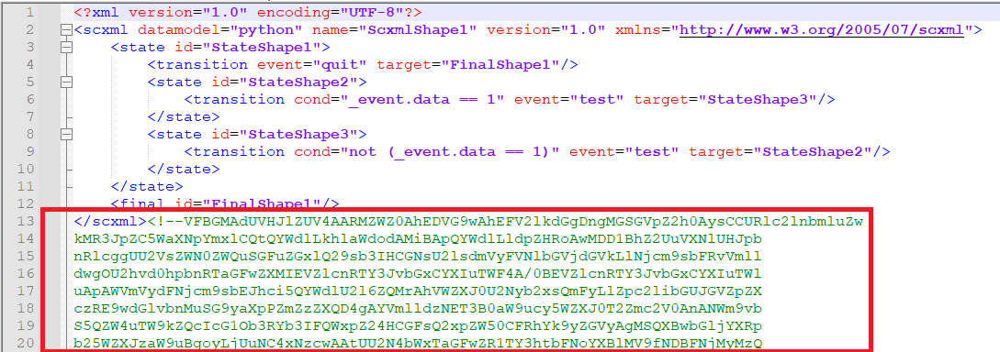

**Purpose**  
Binary metadata ensures exact restoration of the diagram layout and editor details when reopening files in **ScxmlEditor**. It provides full fidelity of the editor state.

**Availability**  
- Always enabled in **single‑file editing mode**.  
- In **Project Mode**, binary metadata can be disabled if textual metadata is preferred.

---

## Textual Metadata (Project Mode Only)

**Description**  
Textual metadata is a human‑readable alternative to binary metadata. It is appended after each SCXML element and provides editor‑related information in text form.

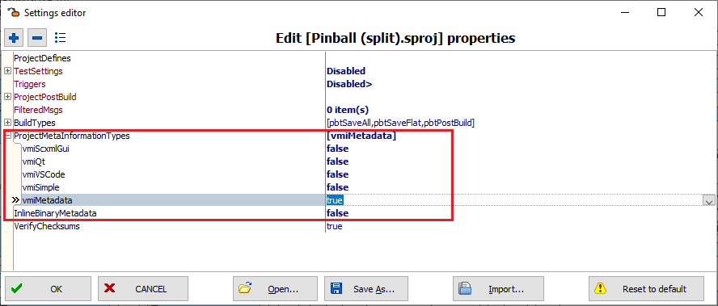

**Activation**  
To use textual metadata:  
1. Switch to **Project Mode**.  
2. Disable the `InlineBinaryMetadata` property.  

**Formats**  
Textual metadata can be written in several formats:

### 1. Qt Creator Format
- **Description:** Compatible with [Qt Creator SCXML editor](https://doc.qt.io/qtcreator/creator-scxml.html).  
- **Use Case:** Ideal when SCXML files need to be opened and edited in Qt Creator while preserving layout coordinates.  
- **Limitation:** Stores only coordinates of states and transitions; no extended graphical information.

| 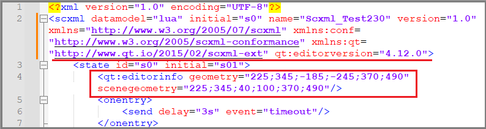 |
|---|
| Example of Qt Creator metainformation |

| 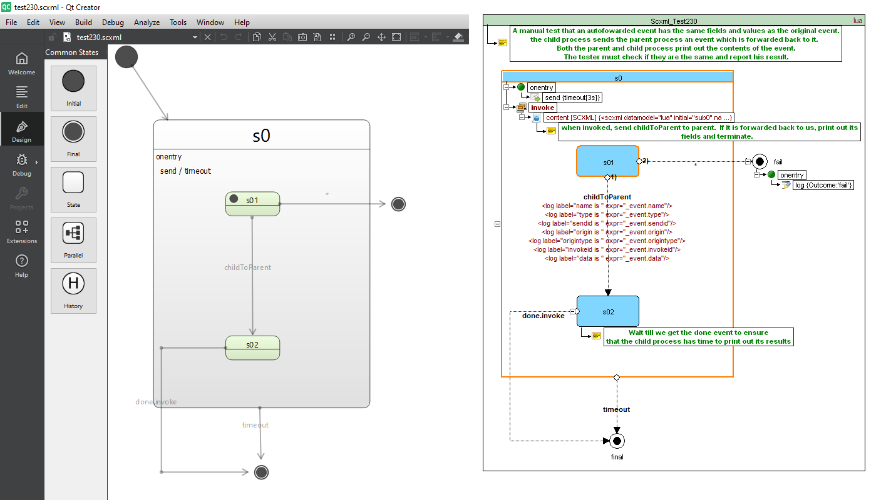 |
|---|
| Comparison of Qt Creator and ScxmlEditor layouts |

> **WARNING:** If self-transition is present in state, it is displayed inside of a state and state width is increased!
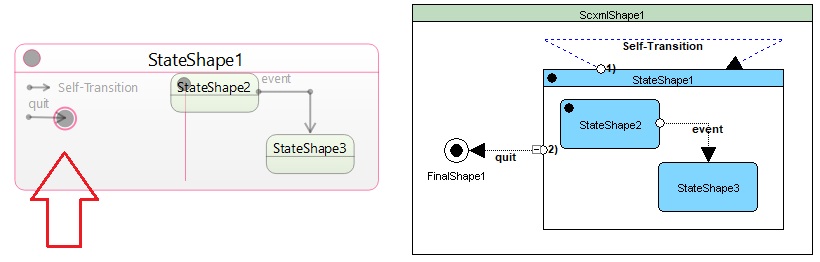

> **NOTE:** Use self-transition location at the left side inside of a state
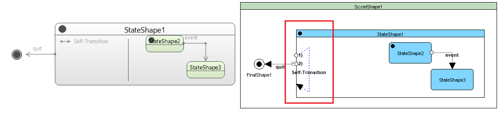

### 2. ScxmlGui Format
- **Description:** Compatible with [ScxmlGui project](https://github.com/fmorbini/scxmlgui).  
- **Use Case:** Useful for workflows that rely on ScxmlGui for visualization or collaborative editing.  
- **Limitation:** Stores only coordinates of states and transitions; no extended graphical information.

| 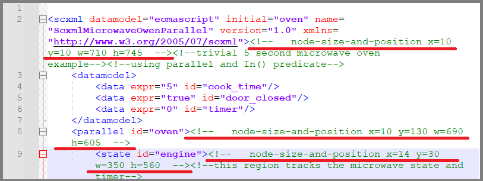 |
|---|
| Example of ScxmlGui metainformation |

| 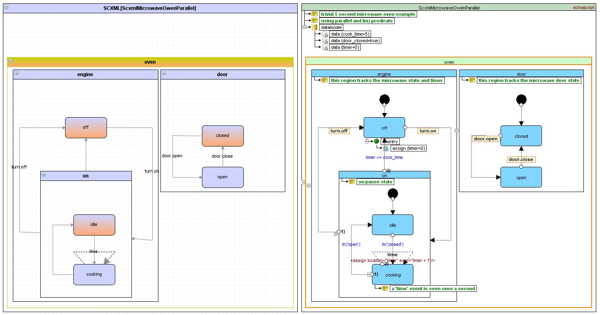 |
|---|
| Comparison of VSCode and ScxmlEditor layouts |

> **WARNING:** ScxmlGui does not recognize UTF8-with-BOM encoding. So use only "Export as ScxmlGui" option, because scxml project files are written with BOM!

### 3. VSCode Format
- **Description:** Compatible with [Visual SCXML Editor for VSCode](https://github.com/Phrogz/visual-scxml-editor).  
- **Use Case:** Best suited for developers working in Visual Studio Code who want integrated SCXML visualization.  
- **Limitation:** Stores only coordinates of states and transitions; no extended graphical information.

| 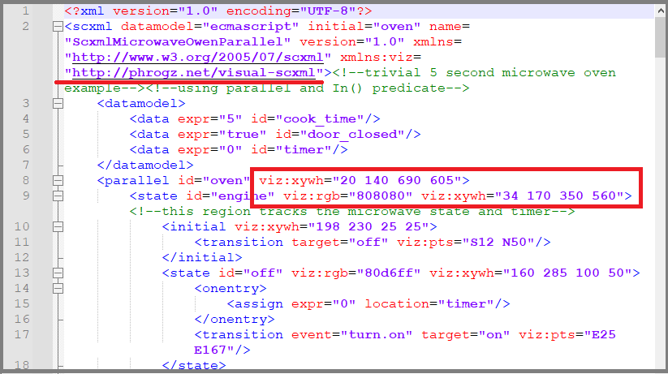 |
|---|
| Example of VSCode metainformation |

| 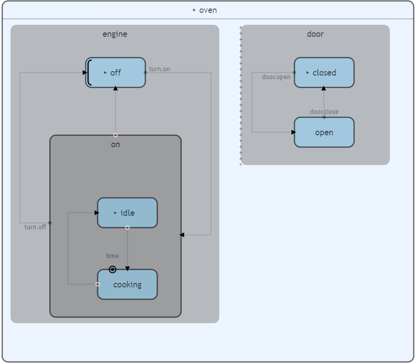 |  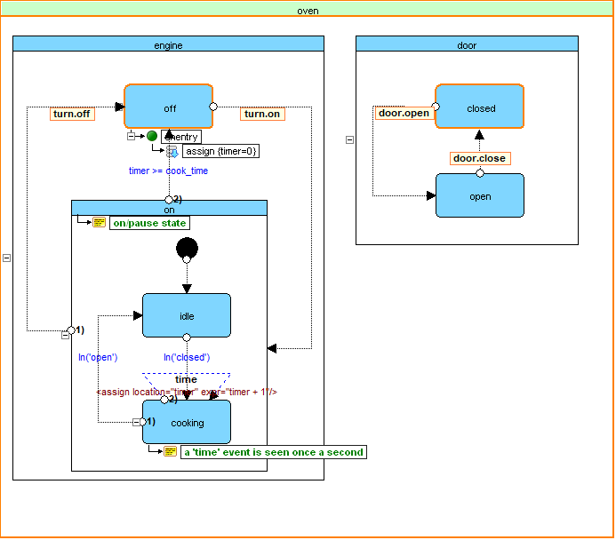 |
|---|---|
| VSCode target layout | ScxmlEditor source layout |

> **WARNING:** Invoked state machines could be wrongly represented by VSCode side!

### 4. Simple Visual Format
- **Description:** Stores only the coordinates of each state and the connection points of transitions.  
- **Use Case:** Lightweight option for minimal visualization needs, focusing purely on geometry.  
- **Limitation:** Does not include any extended editor metadata.

| 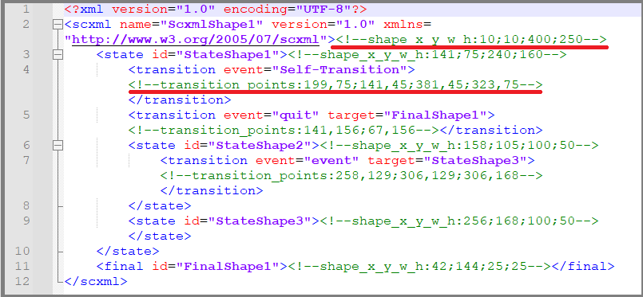 |
|---|
| Example of Simple Visual metainformation |

### 5. Metadata Format
- **Description:** Provides a textual representation of **ScxmlEditor**’s own metadata for each state and transition.  
- **Use Case:** Recommended when full editor context is needed but binary storage is not desired.  
- **Advantage:** Unlike other textual formats, **Metadata format supports extended metainformation** for visual state charts.  

---

### ⚠️ Warning: Limitations of Textual Metadata
Textual metadata does **not** support all visual features of **ScxmlEditor**. Specifically:  
- **Only the Metadata format** preserves extended editor information.  
- Formats such as **Qt Creator, ScxmlGui, VSCode, and Simple Visual** store only coordinates of states and transitions.  
- Features not supported in textual metadata include:  
  - Virtual folders  
  - Triggers  
  - Watch shapes  
  - Inline invoked nested SCXML state machines defined inside the `content` node of an `invoke` parent node  

For projects requiring these advanced features, binary metadata must remain enabled.

---

## Metadata Comparison

| Aspect              | Binary Metadata (Default)                                                                 | Textual Metadata (Project Mode Only)                                                                 |
|---------------------|--------------------------------------------------------------------------------------------|------------------------------------------------------------------------------------------------------|
| **Storage Type**    | Binary block appended at the end of the SCXML file                                         | Textual data appended after each SCXML element                                                       |
| **Availability**    | Always enabled in single‑file editing mode; optional in Project Mode                       | Only available in Project Mode (requires disabling `InlineBinaryMetadata`)                           |
| **Supported Features** | Full fidelity: layout, transitions, annotations, display settings, virtual folders, triggers, watch shapes, inline invoked nested SCXML state machines | Limited fidelity: layout and transitions only. **Only Metadata format** supports extended information; other formats store coordinates only |
| **Formats**         | Proprietary binary format used by **ScxmlEditor**                                            | Multiple formats: Qt Creator, ScxmlGui, VSCode, Simple Visual, Metadata                              |
| **Best Use Case**   | Exact restoration of editor state within **ScxmlEditor**                                     | Human‑readable files, external tool compatibility, lightweight visualization                         |

---

## Usage Recommendations
- Use **Binary Metadata** for full fidelity and advanced features.  
- Use **Textual Metadata** (Project Mode only) for compatibility with external tools or when a human‑readable format is preferred.  
- Choose **Metadata format** if extended editor information must be preserved in textual form.  
- Choose **Qt Creator, ScxmlGui, VSCode, or Simple Visual formats** for interoperability with external editors, keeping in mind their limitations.  

## How to handle [virtual sub states](VisualStateChartSplitting.md) in Qt Creator Mode
If your state chart contains [virtual sub states](VisualStateChartSplitting.md) then [Project Mode](#project-mode-permanent-metainformation-using-project-options) may be unacceptable because it can create a mess in the resulting state chart.

| 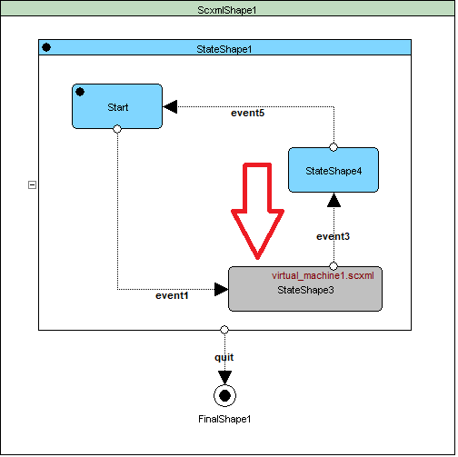 | 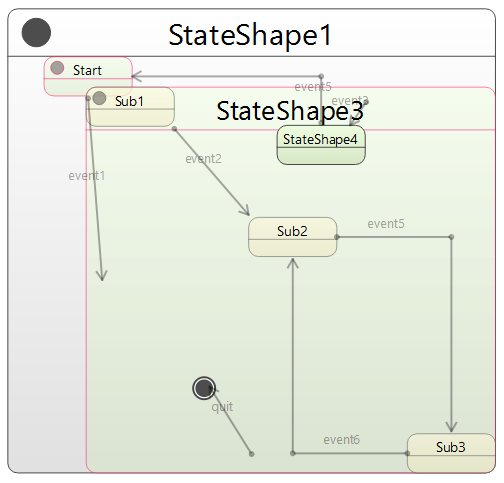 |
|---|---|
| Example of virtual sub state | Virtual sub state layout is messed up |

In this case you can use [post-save](ProjectTree.md#post-save-unit-actions) option to save state chart in [Export Mode](#export-mode-export-file-with-metainformation-by-calling-an-action)

| 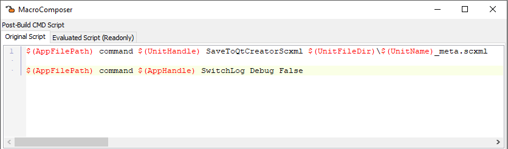 |
|---|
| Exported name is extended with suffix "_meta" |

| 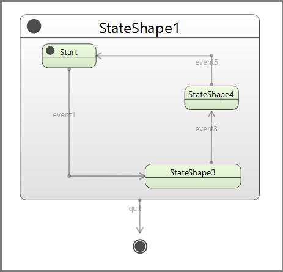 | 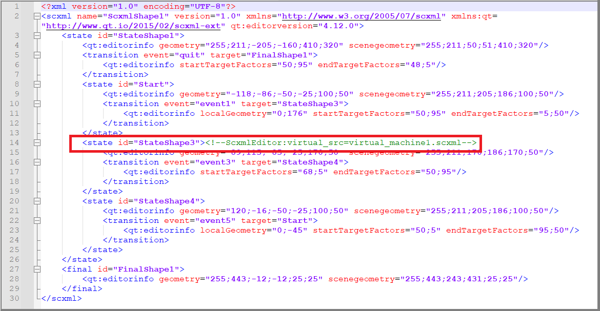 |
|---|---|
| Virtual sub state will be only presented as single state | There will be a comment with the virtual source unit |

---
| [TOP](#top-anchor) | [Contents](../README.md#table-of-contents) | [SCXML Wiki](https://alexzhornyak.github.io/SCXML-tutorial/) | [Forum](https://github.com/alexzhornyak/ScxmlEditor-Tutorial/discussions) |
|---|---|---|---|
